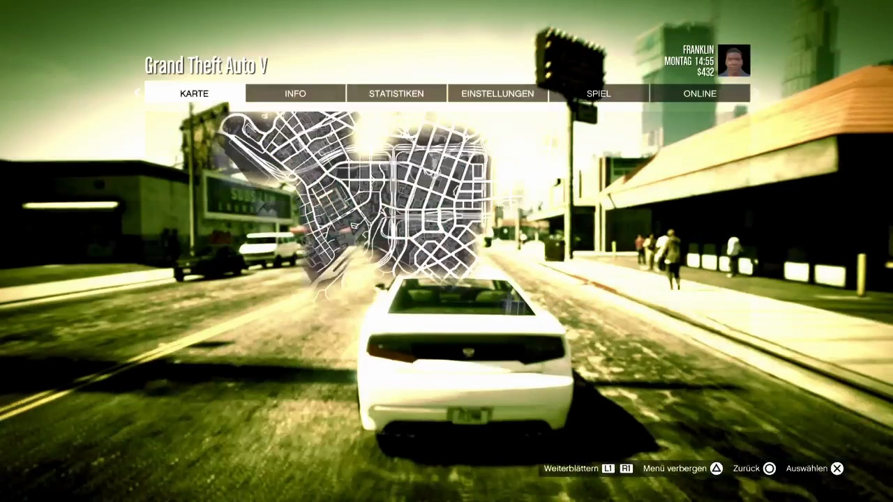
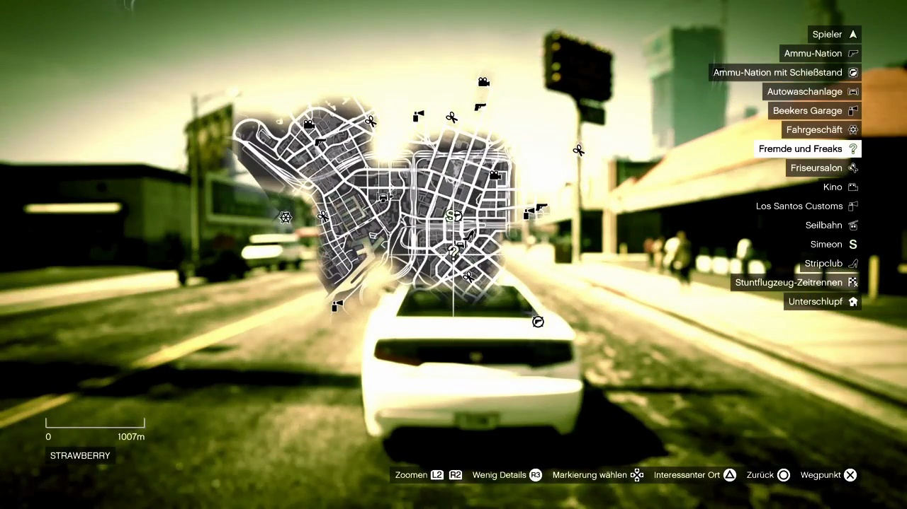
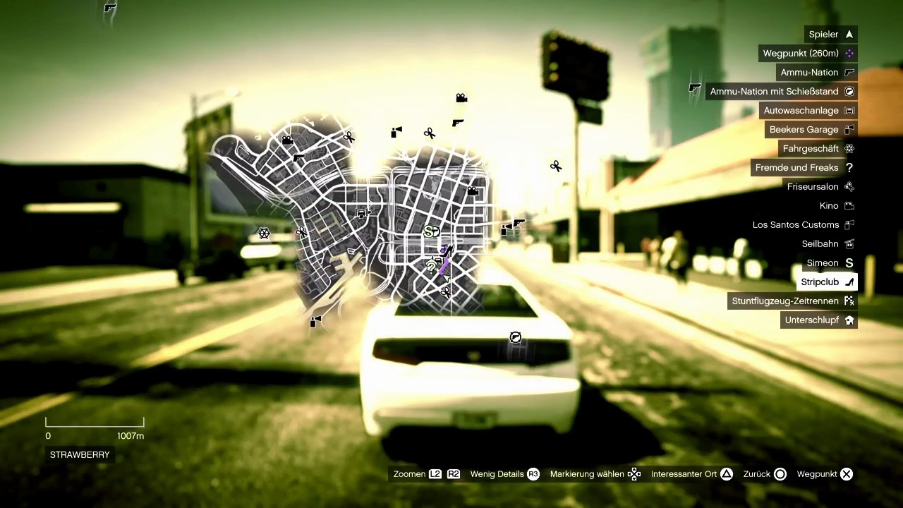

P19 adds the standalone `SetWaypoint` skill in `pilot.waypoint`, its recorded-frame fixtures, safety tests, an offline delayed-picture simulator, and a reproducible recording inspection tool. It offers `mission` and `away`, validates arguments, clamps the duration to 1 to 45 seconds, and always returns a complete pad state. Registration is deliberately left to P13 and the reviewer, as required by the task README. No protected module was changed. The task README's explicit no-Git-write instruction takes precedence for this worker handoff: these changes remain in the working tree, without a commit or pull request.

The controller sends Options once from observed gameplay, verifies the selected KARTE page, enters its interactive map with Cross, identifies a target and the fixed cursor, and checks the target again after each short left-stick movement. Cross on the selected KARTE overview is supported by the recorded sequence; it is a map page, not an arbitrary pause page. The controller does not use shoulders, triggers, PS, Create, or the legend's navigation controls. A failed check permits only neutral output and at most three Circle pulses. It verifies gameplay after each pulse and records whether escape was observed. Stop, replacement, invalid time and all terminal results are neutral. The hard deadline takes precedence over completing the escape sequence, so a timeout can leave the menu open and explicitly asks for screen verification before retrying.

The source is the read-only recording `20261110-093238`. Its MP4 is approximately 473.8 seconds long but its capture timeline is 695.9 seconds. `frames.jsonl` maps capture times to decoded frame indices; seeking the MP4 directly to 385 seconds inspects the wrong scene. Every frame from index 8191 through 8315 was inspected and labelled as map. These cover capture times 384.903 through 392.477 seconds, including damaged transition pictures. The first map-free picture is index 8316 at 392.568 seconds. `lab/waypoint/pad-clip.json` preserves the surrounding human input events; the map contact sheets preserve every labelled positive, and the non-map contact sheets show all negative samples.

The recorded input sequence is Options at 384.1301 seconds, released at 384.2765; Cross at 386.1264, released around 386.279; several left-stick movements between 386.578 and 390.598; Cross at 391.2211, released around 391.360; Circle at 391.9319, released at 392.0536; and Circle again at 392.1333, released at 392.259. Inputs lead the picture by approximately 0.6 to 1.1 seconds on this Wi-Fi recording. The implementation releases each pulse after 0.10 seconds and then waits 1.3 seconds before a new visual decision. The pulse duration and map movement gain are assumptions, not measured console calibrations.

The first picture shows the white selected KARTE tab, the other pause tabs and a small city map over the paused scene. Cross subsequently opens the interactive map. The footer reads Zoomen L2/R2, Wenig Details R3, Markierung wählen, Interessanter Ort, Zurück and Wegpunkt. The legend includes Spieler, shops, activities and Simeon S. Those hints suggest zoom, detail switching and marker selection, but this clip does not demonstrate their behavior. There are no trigger or directional-pad trials that establish a reliable jump to a mission category. The left stick moves streets and icons beneath a fixed crosshair at approximately (640, 360); it does not move the crosshair around the screen.

Purple route or waypoint geometry appears near the cursor in index 8305 at approximately 392.090 seconds, after the second Cross. It is absent in the preceding control frames, including index 8286. The two recorded Circle pulses are followed by the tab overview and gameplay; the picture delay does not isolate the exact effect of each individual Circle. Purple routing is visible in the gameplay minimap afterwards. This proves waypoint setting in the clip, but not the selection of a letter-marked story mission.

The open-map check combines OCR and the selected tab's brightness, or the interactive map's specific footer labels. Recognisable mixed transition pictures are classified as transitions and cannot authorise a forward input. The final inspection found 125 of 125 map pictures and zero false maps among 404 other pictures sampled every two capture seconds from both recordings. The 404 negatives were visually checked in the contact sheets, including codec damage. Explicit examples are the weapon wheel at index 10940, time 538.037; failed-mission pictures at indices 856 and 886, times 38.030 and 39.991; and cutscene pictures at indices 7172 and 7211, times 333.986 and 336.000. The negative sample is a finite regression set, not evidence about every possible menu, localization or video fault.

`cd pilot && .venv/bin/python tools/inspect_map_clip.py --output ../lab/waypoint` produced `map_frames: 125`, `map_missed: []`, `non_map_frames: 404`, and `false_maps: []`. The complete output is in `lab/waypoint/inspection.txt`; `classification.json`, `labels.json` and the OCR cache make the decisions inspectable. Initial OCR generation required access to the local macOS Vision service outside the sandbox. It used only recording files and wrote only this task's artifacts. Cached inspections need no native OCR call. Tests include lossless source frames and cached OCR, including the weapon wheel, failed mission, cutscene, transition, selected tab and waypoint evidence.

`cd pilot && .venv/bin/python tools/sim_waypoint.py` produced 78 scenarios in `lab/waypoint/simulation.json`, with concise results in `simulation-summary.jsonl`. Both targets succeeded with picture delays of 0.14, 0.6 and 1.1 seconds: mission in 12.75 seconds and away in 16.90 seconds, with two exits each. All 66 combinations of six decision phases and eleven wrong screens failed with neutral terminal pads. The wrong screens include settings, online, store, pause, weapon wheel, phone, failed, passed, wasted, busted and loading. Six additional scenarios made Circle ineffective; all stopped after three attempts, in at most 14.15 seconds. The simulator asserts that no forward input follows a failed check and no prohibited button occurs. Its renderer passes actual pixels through the map reader and tracker; the text reader is supplied synthetic OCR lines, so simulation does not validate native OCR or real console input timing.

The chosen target policy is deliberately explicit. Mission means the nearest visible, recognised letter marker relative to a uniquely recognised player icon. Letter templates come from the visible legend; this does not discover off-screen missions or prove global nearest distance. Away means a uniquely trackable road stroke at least 140 screen pixels from the player. That pixel separation is not a calibrated world distance. Matching rejects ambiguous targets, missing player icons, non-progressing movement and pre-existing waypoint evidence at the selected point. The fixed crosshair is excluded from target correlation where it occludes the moving target. Completion requires new purple evidence on the map and observed gameplay with a purple minimap route.

There is an important remaining perception limitation: the clear interactive frames in this Wi-Fi clip do not produce a unique player or mission-letter match at the conservative thresholds. Their screen, cursor and purple waypoint are recognised, but the skill would back out when acquiring a target. The simulated targets work; autonomous target selection on actual console footage is not established by this report. The captured icons overlap or differ from their legend templates, and the recording does not supply an unambiguous mission-selection demonstration. The current recogniser also assumes the recorded German UI and 1280×720 frame contract. It fails closed elsewhere. Identical pictures after an input are rejected as stale; the current Observation API has no capture timestamp, so pixel comparison cannot prove freshness of a different, replayed old frame.

The supervised console trial order is: first verify Options opens the selected KARTE page and one Circle returns safely; then verify Cross enters the interactive map and separately measure each Circle's return screen; then collect clean player and mission-letter pictures and validate their recognition, including an overlapping icon; then measure one short left-stick pulse in each axis, its gain, delay and neutral release; then validate nearest visible mission selection and the road criterion and distance for away; finally set one waypoint, inspect the new purple marker or route, return to gameplay and verify the purple minimap route. Trigger zoom, detail changes and legend jumping remain unsupported assumptions and are not used. No live daemon, console command, credentials or hardware was accessed during this task.

The required default gate passed: `cd pilot && .venv/bin/python tools/gate.py` reported `All checks passed!`, `52 files already formatted`, `540 passed, 1376 deselected, 4 xfailed in 49.86s`, and `gate passed in 50.14s (default)`. The waypoint test file contributes 130 tests. Evidence is in `lab/waypoint/gate-local.txt`. The earlier restricted-sandbox attempt in `gate.txt` failed only in four existing overlay HTTP tests because binding a temporary loopback port raised `PermissionError: [Errno 1] Operation not permitted`; the successful run used the same gate with local-port permission and no code or test bypass. The working-tree status contains only the task-authorised module, test fixtures, tools, lab artifacts and this report. Offline acceptance evidence is complete; registry integration and the supervised console checks described above remain open.

## Review

Checked in the night of 10 to 11 November. The skill is careful in the right places and useless on real pictures in one: as the report says itself, on the clean frames of the recording it recognises the map, the cursor and the waypoint, but neither the player's marker nor a mission letter, so today it would open the map, find no target and back out. That is harmless and it is not a waypoint. It is merged because the map check, the bounded back-out and the proof of the waypoint are what the next step builds on.

Sixteen breaks were tried against the tests and five were not noticed: pressing Options without having seen gameplay, the check that the cursor approaches its target, the limit of sixteen cursor moves, the guard against switching an existing waypoint off, and acting on a damaged map picture. All five are pinned now, and each of the new tests fails when its line is broken.

Two things were changed. A skill that does not start from visible gameplay used to back out with Circle up to three times although it had opened nothing; on the failed screen Circle leaves the mission, and in the game it throws a punch. It stops now without pressing anything. And the skill counted as done only when the purple route showed on the minimap afterwards, which the game draws in a vehicle and not on foot; a waypoint proved on the map and gameplay seen afterwards is done now, and the reason says whether the route is visible yet.

`lab/waypoint/simulation.json` is rebuilt by `tools/sim_waypoint.py` and stays out of git.

What follows from the limitation: the target "away" does not need a marker at all. The map opens centred on the player, the game snaps a waypoint to the nearest road, and the recording has Kerim's stick next to the moving map, so the pan speed can be measured instead of assumed. Pushing the map a measured distance in one direction and dropping the waypoint under the cursor gives the pilot somewhere to drive without recognising anything but the waypoint itself. That is card P19b. The mission letters need clean pictures of the map over the cable, which do not exist yet.
