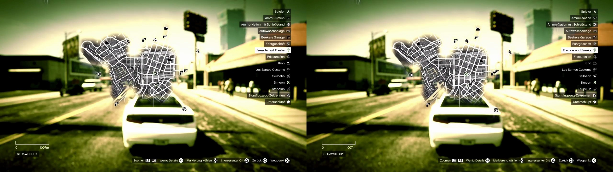
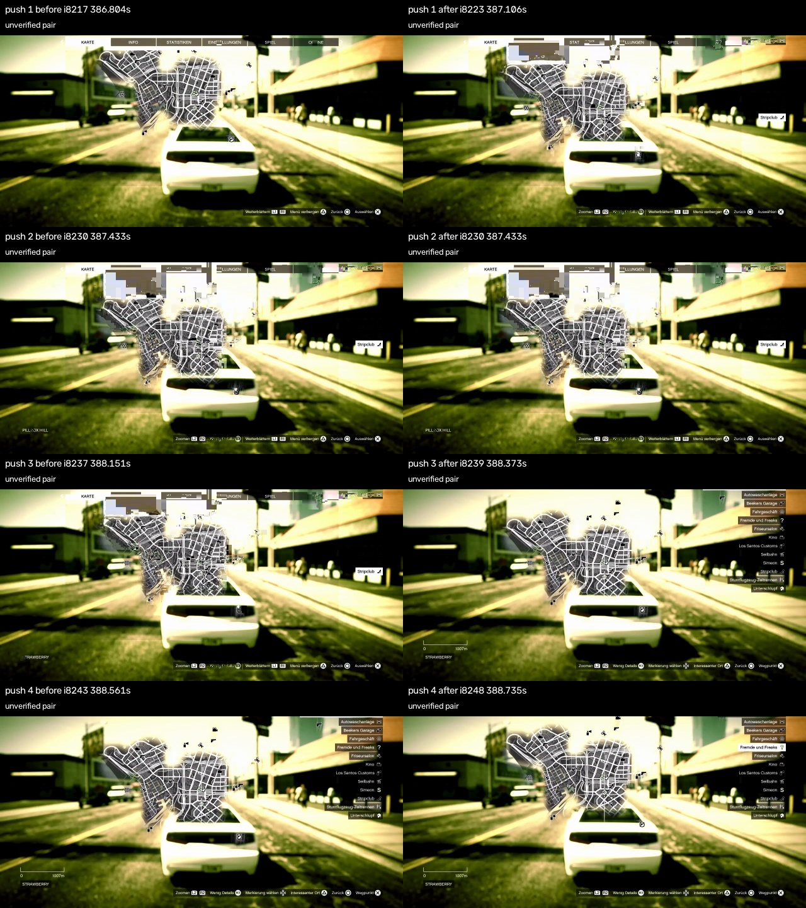
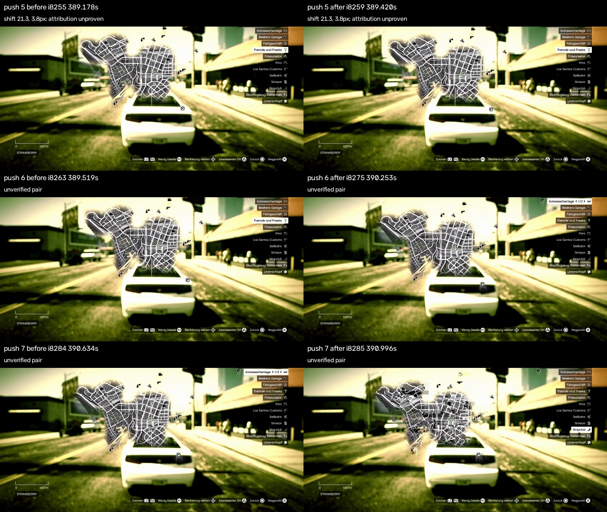

P19b replaces only the away target's acquisition and panning. It no longer needs a player marker, mission letter or uniquely matched road target. Mission selection retains its existing behaviour. The gameplay start check, selected-map check before every new press, purple waypoint proof, three-Circle escape bound, neutral terminal state and 45-second maximum remain in place. The concurrent `opens` attribute was not added or touched. Changes remain in this task worktree for the reviewer, following the explicit worker handoff in `docs/tasks/README.md`; no commit, push or pull request was made.

The new arguments are `direction=any|north|east|south|west` and `distance=near|far`. Any rotates through north, east, south and west using the class's own counter. Near requires 100 pixels of measured net map translation and far requires 220. These are map pixels at the current zoom, not guaranteed road distances. The recorded scale bar is about 140 pixels for 1007 metres, making these approximately 0.7 and 1.6 km of map separation at that zoom. The first interactive picture being centred on the player still needs a console check.

Each attempt starts with a 0.10-second pulse at 0.65 stick deflection. After neutral release it waits the existing 1.3 seconds, verifies the map and cursor again, and measures the actual translation. Later pulses use the observed pixels per pulse-second to aim for at most 60 more pixels, bounded to 0.10–0.40 seconds. Neither the initial speed nor elapsed time can satisfy the distance condition. At most sixteen pushes are allowed. A measured shift below two pixels, including an identical picture, receives exactly one clockwise alternate-direction attempt; a second unmoved result fails. The unchanged-picture exception applies only to the away pan phase so this retry is possible. Opening, confirmation, mission navigation and gameplay return retain their stale-picture guards. Wrong-axis motion, insufficient texture and ambiguous measurements fail without setting a waypoint.

Known damage or a missing picture stops away immediately, including during a held pulse or its settling interval. The measurement uses both full-resolution RGB pictures, seeds up to 250 neutral bright road features within x=230..979 and y=165..564, and masks the fixed centre cursor at x=580..699 and y=300..419. It excludes the tabs, legend and footer and avoids features from the coloured paused scene. Pyramidal optical flow must agree forward and backward within 1.5 pixels, have tracking error below 20, retain at least 65 percent of its seeds and at least sixteen points, and have at least 80 percent of those points agree on translation within two pixels. Support must span 100 by 80 pixels. At least 85 percent of matched 11-by-11 patches must differ by fewer than 25 mean gray levels. A rejected pair adds no distance and permits only neutral output followed by bounded Circle escape. These are conservative visual checks, not a decoder-integrity certificate: small damage outside the sampled evidence and replayed nonidentical frames remain possible because Observation has no capture timestamp.

Water and uncertain terrain are excluded by requiring neutral dark terrain and visible edges in a 65-by-65 patch around the cursor, with the cursor itself masked. A flat sea patch cannot authorise Cross. After reaching the requested distance on water, the skill takes one reverse-direction look toward the previously visible area. It sets a waypoint only if that next picture proves both movement and land; otherwise it fails. This inland correction can shorten the final net distance after the requested distance was already reached, but cannot return to within two pixels of the opening position. This is the chosen interpretation of the card's second inland look, without coastline logic. An existing purple waypoint is never toggled off. The flat-water detector is conservative and can also reject featureless land; real coastal and inland examples still need console confirmation.

The recording cannot support a reliable fixed gain. `cd pilot && .venv/bin/python tools/inspect_map_clip.py --measure-only --output ../lab/waypoint` fits the piecewise integral of every recorded stick state to picture translation, searching delays from 0 to 1.50 seconds in 0.01-second steps. The model is `map shift = -gain * integral(stick(t - delay))`, with one scalar gain and zero intercept. Of 113 adjacent pairs between indices 8191 and 8304, 47 pass the visual checks; 66 are rejected. Entry-animation and mixed-damage pictures before index 8252 are excluded from calibration. Twelve accepted pairs contain more than one pixel of motion. The least-bad fit is 129.702 pixels per second at full deflection, delay 0.22 seconds, vector R² 0.408343 and RMSE 3.551759 pixels per pair. This is below the explicitly chosen R² 0.8 threshold and outside the previously observed Wi-Fi delay range. Restricting to 0.6–1.1 seconds gives R² 0.135988 at 1.09 seconds and an implausible negative gain of −81.193. Neither result is a calibration. The runtime therefore measures its own first push and never uses these fitted constants.

The reproducible fit, every accepted/rejected pair and every delay candidate are in `lab/waypoint/p19b-measurement.json`; concise output is in `p19b-measurement.txt`. The clear pair at indices 8255 and 8259, capture times 389.1781 and 389.4197, measures +21.253 pixels horizontally and +3.808 vertically. The street grid visibly moves right and slightly down while the scene and UI remain fixed. A single added lossless fixture at index 8255 tests the independently visible +10.77/+2.26 shift from existing fixture 8252, and its reverse, using the same runtime estimator.

The per-push contact sheets cover all seven continuous stick bursts, using magnitude below 0.05 as neutral and the least-bad fitted delay only to choose illustrative pairs. This delay does not establish causal attribution. The first burst at 386.5782–386.9136 selects frames 8217/8223: the map visibly changes during entry and the after-picture has block damage, so no shift is accepted. The second at 387.2781–387.4382 maps both boundaries to damaged frame 8230, so there is no usable pair. The third at 387.9078–388.1263 selects 8237/8239: the first picture is damaged and no shift is accepted. The fourth at 388.3280–388.5098 selects 8243/8248: the map is visibly different, but this is inside the excluded entry/damage interval, so no calibration shift is claimed. The fifth at 388.9541–389.1601 selects 8255/8259 and gives the +21.253/+3.808 shift described above, with attribution still unproven. The sixth at 389.3934–390.0342 selects 8263/8275: the map visibly changes but the pair fails correspondence checks. This interval contains two directional sweeps; the stick remains at x=0.18 between 389.6508 and 389.7640, so it is one continuous burst rather than two neutral-separated pushes. The seventh at 390.3977–390.5981 selects 8284/8285: the after-picture has obvious map block damage and no shift is accepted. None of the rejected pairs is reported as zero movement.

The existing recording inspection remains green. `cd pilot && .venv/bin/python tools/inspect_map_clip.py --output ../lab/waypoint` reports `map_frames: 125`, `map_missed: []`, `non_map_frames: 404`, and `false_maps: []`. Its output still reads `waypoint=True` at frame 8305 and `waypoint=False` at 8286. Evidence is in `lab/waypoint/p19b-inspection.txt`, with the existing classification and contact sheets unchanged. The finite recording set does not prove other UI languages, resolutions or map styles.

The offline simulator covers both original target/delay cases, near and far at 65, 130 and 260 pixels per full-stick second with each of 0.14, 0.6 and 1.1 seconds of picture delay, an unmoving map edge, open sea, damage between pushes, every original wrong-screen phase, every away wrong-screen phase including pan, and ineffective Circle backout. Since there is no valid measured gain, 130 is explicitly a rounded experimental reference, with half and double values; the original 1200 reference is retained for regression cases. Away worlds omit the player and mission markers. Each trace checks complete neutral termination, no prohibited buttons, no forward input after failure, and no map Cross on water or a damaged picture. The final `cd pilot && .venv/bin/python tools/sim_waypoint.py` passed all 171 cases: 24 completed with a proved waypoint and observed gameplay, and 147 failed closed as expected. The maximum duration was 30.95 seconds. At the 1.1-second picture delay, near/far took 19.00/30.95 seconds at gain 65, 13.65/20.75 at 130, and 11.75/15.00 at 260. Full traces are rebuilt in the already ignored `lab/waypoint/simulation.json`; the compact results are retained in `p19b-simulation-summary.jsonl`.

Tests pin variable measured distance rather than a fixed number of pushes, the one alternate direction, damage before/during/after input, unflagged texture destruction, flat sea rejection, a successful second inland look, counter rotation, argument validation and the real map translation. All existing P19 tests are retained. The first sandboxed baseline gate failed only in four existing overlay tests because their temporary loopback HTTP port could not be bound; it reported 650 passed, two skipped and four expected failures. The final `cd pilot && .venv/bin/python tools/gate.py` used permission for those ephemeral local test ports and no access to the console daemon. It reported `All checks passed!`, `62 files already formatted`, `681 passed, 1376 deselected, 4 xfailed in 46.66s`, and `gate passed in 46.88s (default)`, below the 90-second limit. The unchanged P19 tests and the new cases all pass. Evidence is in `lab/waypoint/p19b-gate.txt`.

No console, daemon, remote-play command, credential or network provider was used. Before relying on this on the console, first verify visible gameplay opens the selected map tab and each Circle returns to the expected screen. Next verify Cross enters the interactive map and whether its first picture actually centres the player. Then, on a clean wired feed, try one short pulse in each cardinal direction and confirm the sign of the map shift, neutral release and observed delay. Next verify near, far and repeated any selection with a visible waypoint and gameplay return, including a route in a vehicle. Then check a map edge, flat sea and the single inland correction, a deliberately damaged or delayed picture, stop and the hard timeout. Finally verify mission recognition separately; this card does not resolve P19's missing player and mission-letter recognition in the Wi-Fi recording. A timeout may leave the menu open and explicitly requests screen verification before retrying.

## Review

Checked in the night of 10 to 11 November.

The away target is what the card asked for, and the worker was right not to trust the clip: the fit of map movement against Kerim's stick explains two fifths of the variance at best, so the skill measures its own pushes and nothing depends on a fitted number. On the real map frames in the fixtures the new checks behave: the texture check passes on every clean map picture, the land check does not reject the city, and the shift between frames 8252 and 8255 is measured as the eye sees it.

One thing was added. Which way the map moves under the stick also comes from that weak fit, and with the sign wrong every call would have ended after its first push with "wrong direction". The first push that moves the map now settles the question: if the map runs the other way, the stick is turned, once, and the push counts. After that a map that reverses is a fault as before.

Thirteen breaks were tried and eight failed a test. Two are guarded more than once (scattered features and patches that do not match, in the shift measurement). Four were not noticed and are pinned now: a pair of pictures that cannot be compared was counted as a push, the limit of sixteen pushes, the length of a push following the measured speed, and the check that the map has detail before the first push. The simulation's cases pass with the change.

What stays open is all on the console, and the report's order is right. Two things to add to it. The wait of 1.3 s after every press was sized for the Wi-Fi picture delay; over the cable it can be a third of that, which is the difference between twelve and thirty seconds with the map open. And the pushes are short on purpose, so a far waypoint at a slow map takes most of the time limit.
