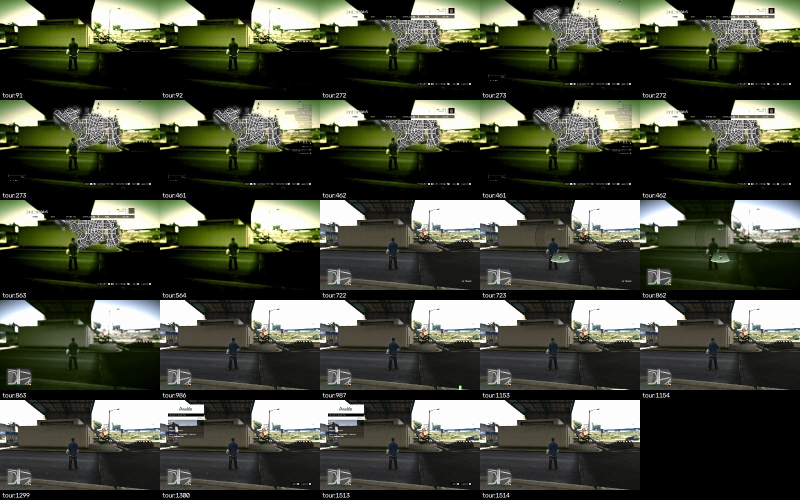
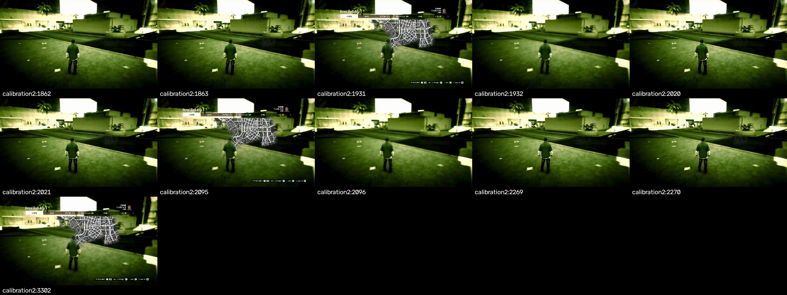
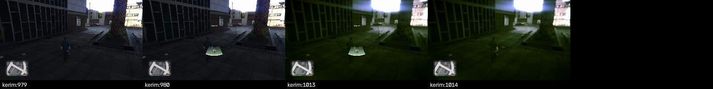

P27 replaces the background-dependent menu crops in `hud.read()` with masked printed UI anchors for pause, map, weapon_wheel and phone, and adds interaction_menu. The reader remains stateless and uses no OCR or external I/O. Pause requires both the printed shoulder-button controls and the title glyphs, preserving the damaged Wi-Fi menu fallback. The interaction menu returns no gameplay HUD values. Existing health, wanted and death recognition is unchanged. Nine new full-frame fixtures cover pause over both cable backgrounds, the other four menu classes, driving, wanted stars and fighting.

The exhaustive cable evaluation decoded 60,997 frames and found zero false stops in all 58,793 labelled ordinary-play frames. Mean `hud.read()` time was 0.666 ms, below the 1 ms requirement, excluding video decode and RGB conversion. Every false-stop list is explicitly empty in [evaluation.json](../../lab/screens/evaluation.json). The counts are pilot1 0/14,389, pilot2 0/14,312, Kerim 0/22,445, camera 0/831, calibration1 0/1,631, tour 0/3,059 and calibration2 0/2,126. Kerim's frames 980–1013 show a real weapon wheel: all 34 are correctly recognized and excluded from ordinary-play counts. The original 22,479-frame recording is fully accounted for.

Visual labels include partial menu fades and the moving phone, so misses during those transitions remain in the denominator. On the tour, pause hits 275/283 visible frames: 173/181 for frames 92–272 with first detection at 100, 142.0 ms after first visible UI, and 102/102 for frames 462–563 with zero delay. Map hits 189/189 at 273–461, weapon_wheel 140/140 at 723–862, and interaction_menu 214/214 at 1300–1513, all with zero first-frame delay. Phone hits 132/167 at 987–1153 (79.0%), first detecting frame 1001 after 235.6 ms. It then misses the upward bounce at 1002–1011, detects continuously at 1012–1142, and abstains while the body slides away. This is not a claim of continuous phone detection during animation.

The second calibration contains three visible pause episodes, not one continuous menu. Frames 1863–1931 hit 60/69 with 155.8 ms delay; 2021–2095 hit 66/75 with 156.9 ms delay; 2270–3302 hit 1024/1033 with 156.3 ms delay. The last episode ends at the recording boundary with the menu still open. There is no observed closing time for that episode. Across both sources, pause hits 1425/1460 visible frames (97.6%). Delays use the recorded `frames.jsonl` timestamps, never controller-event timestamps or nominal video FPS.

[labels.json](../../lab/screens/labels.json) contains inclusive visual boundaries, source paths, frame counts and metadata hashes. Overview contact sheets located transitions; frame-by-frame full images and native-resolution crops established the first faint glyph and last visible menu frame. Tint-only transitions count as game. The following compact sheets show the preceding frame, first visible frame, last visible frame and following frame for each labelled episode, omitting the unavailable post-EOF frame. The larger inspected sheets remain locally under [lab/screens/review](../../lab/screens/review), with reproduction instructions in [README.md](../../lab/screens/README.md).

All 30 cable/Wi-Fi background composites classify correctly. Frozen foreground masks retain only the printed glyphs and their opaque outlines; every other pixel, including space between letters, is replaced with driving, wanted or combat footage. Removing those retained glyphs restores game in all 30 negative controls. This tests the identified UI supports rather than carrying an entire source-background rectangle into the composite. [composites.json](../../lab/screens/composites.json) lists every result; [preview one](../../lab/screens/review/composites-0.jpg) and [preview two](../../lab/screens/review/composites-1.jpg) show the actual composites. The fixture manifest records decoded RGB hashes and capture times.

P15 passes unchanged: 193/200 screen labels correct (96.5%, previously 96.0%), 110/110 ordinary frames correctly remain game, health within 0.05 on 68/73 labels, mean 0.455 ms. The seven remaining screen misses are listed in [p15-evaluation.json](../../lab/screens/p15-evaluation.json): the phone transition at 3422, passed transitions at 7277 and 7279, and damaged/mixed pause frames 8221, 8224, 8230 and 8237. No previous test expectation or label was changed.

P25 also passes unchanged, including its full-recording scan: 1,071 labels, 535 correct readable wanted results, 135 abstentions, zero wrong readable counts and zero false positives among 853 no-star labels. Mean time is 0.487 ms. Both clean recordings have no positive wanted false alarms and wasted has no detections outside the labelled death window. The longest raw wanted abstention spans Wi-Fi frames 10929–10972, 44 frames or 2.4332 seconds, during the weapon wheel; this remains an abstention, not a reported zero. Details are in [p25-evaluation.json](../../lab/screens/p25-evaluation.json).

From the repository root, `pilot/.venv/bin/python lab/screens/evaluate.py` prints `60997` frames, `58793` ordinary frames, `false_stop_count: 0` and `passed: true`. `pilot/.venv/bin/python lab/screens/composites.py` prints `30/30 composites correct`. In `pilot/`, `.venv/bin/python -m pytest tests/test_hud.py -q` passes all 102 tests. The P15 command is `.venv/bin/python tools/evaluate_hud.py --recordings /Users/kerim/Documents/ChatGPT/gta/recordings --clean-recordings /Users/kerim/recordings/pilot --output ../lab/screens/p15-evaluation.json`; adding `--wanted --full-recordings` and changing the output to `../lab/screens/p25-evaluation.json` reproduces P25. Both return success. The default gate command is `.venv/bin/python tools/gate.py`. Inside the worker's sandbox it could not pass, because the object detector and the socket tests are not available there; the review below has the result from outside it.

The new class is named interaction_menu. The image shows Zurück bound to Circle; the reviewer should release held controls and dismiss it with Circle through the existing menu-handling path. `flow.py`, `contract.py`, `conductor.py` and `calibrate.py` were deliberately left untouched because the card excludes them. This task proves the offline reader and does not claim that the live flow already handles interaction_menu. Failed, passed and wasted have no labelled cable footage and remain unmeasured on cable. The evidence is limited to the recorded German 1280x720 layout, not arbitrary safe areas, characters or phone skins.

The task's README says, “Git cannot write here: no commit, stash, checkout or reset. Leave your changes in the working tree; the reviewer commits them.” Changes therefore remain on the supplied feat/pilot-screens worktree without a commit or pull request. No live daemon, console control, remote-play configuration or network service was accessed. The final source formatting was applied after the recorded timing scans; no detection logic changed during formatting.

## Review

The worker was stopped when its session ended, before it could record a gate result, and the gate log it left was the sandbox failing on the object detector, not on this change; that log is removed. Run by the reviewer in the worktree outside the sandbox on 11 November, the default gate passes with 1098 tests in 65 s, and `lab/screens/evaluate.py` reproduces the report: 60,997 frames, no false stop on any of the 58,793 frames of ordinary play, 0.50 ms per reading.

Three deliberate breaks, each caught by `tests/test_hud.py`: the map anchor accepted at 0.30 instead of 0.88, the pause menu taken from its footer alone at 0.30 without the title glyphs, and the interaction menu allowed to go on reading the gameplay HUD.

Nothing in the reader was changed in review. The interaction menu is wired into the screen reflex in a change of its own, since that is the path that sends inputs. Still without footage over the cable: the failed, passed and wasted screens and the arrest.
