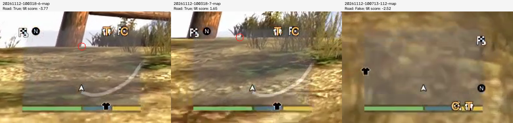
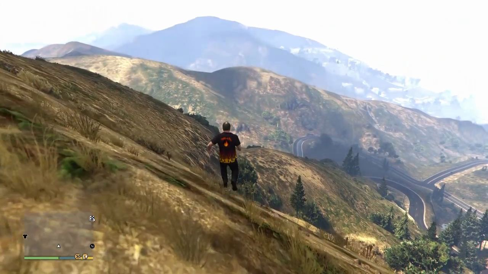
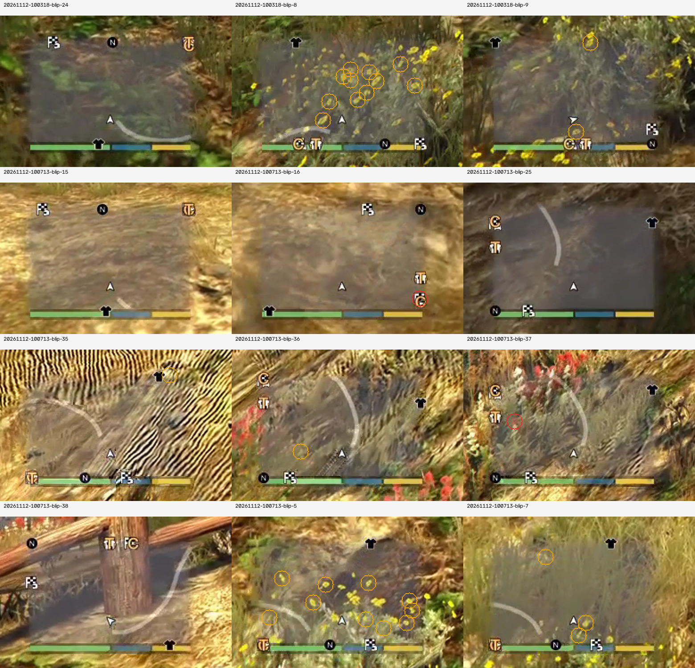
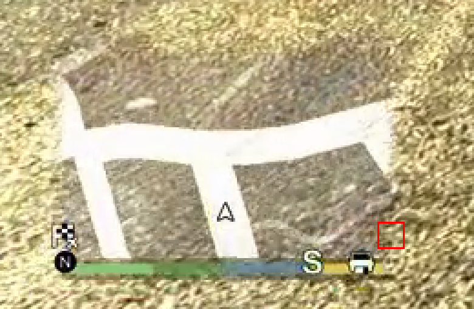
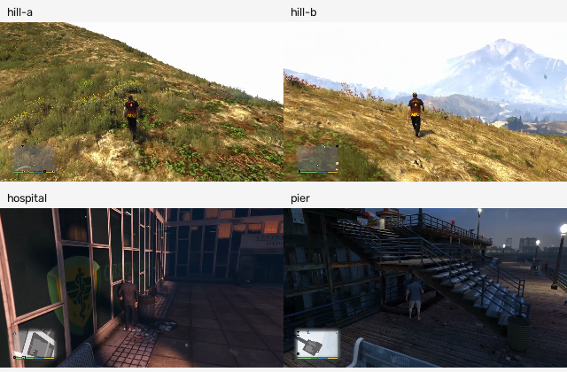

P50 implements compass-based roadless walking, world-image motion evidence and stricter blip reading. The changes remain in the worker worktree, without a commit or pull request, as docs/tasks/README.md requires. No daemon, controller, PS5_HOST, console configuration or live session was used. Source recordings were read only. This is recorded-frame validation; it does not establish that the new commands have taken Trevor to a road on the console.

The first finding is a false road acquisition followed by loss of the brightness signal. In 20261112-100318 the first walking skill sees components at 5.873–6.048 s and 6.567–7.176 s, with an isolated further hit at 17.762 s. Its first fifteen-second interval ends normally at 20.888 s; the following eleven attempts end no-road. The selected point at about 6 s is sky and fence visible through the transparent radar, above the gray curved map line. The point in the next crop is also in the upper background. The reader thresholds S < 45 and V > 195, removes broad white sheets and keeps long connected bands, so changing scenery and brightness can both create and remove a candidate. The identity of the gray curve itself is not established by this recording. Tightening V to 235 does not separate the measured background components (median V 238, 237 and 246) from roads, so no unvalidated road-color threshold was added.

In 20261112-100713 the first road candidates occur during camera preparation. The first walking attempt ends no-road at 6.877 s and the next at 19.499 s. The road visible down in the valley at about 112 s is in the world image, outside the radar area. find_road only reads the radar crop and returns None there. Longer radar detections do not occur until roughly 213.6–227.3 s. The following image marks the reader-selected points in red and shows the 112 s crop alongside them.

The second finding is colored scenery and glyph fragments, not destination discs. The exact request crops show yellow flowers and ground through the radar; the red fragments occur in scenery and the edges of the N, letter and HUD glyphs. Clothing, letters and FS symbols are actual game icons, but their colored fragments are not the target discs assumed by the rule. The contact sheet circles detections made by the previous stateless reader; the JSON also retains the original temporally filtered request blips. Every one of the twelve affected request crops now reads no blips. Yellow components need a median core brightness of 240; all fifteen labelled yellow targets in the existing corpus are at least 245, while the measured hill fragments are at most 212. Red components need core brightness of 70 and saturation of 130, removing dark compression speckles and weakly red terrain. Blue recognition and the meaning of a genuine unasked interior red target are unchanged.

All 80 existing labelled blip-corpus readings are exactly unchanged, not merely above the old recall threshold. Comparing every existing 170 by 260 PNG fixture finds one corrected reading: foot_road_b.png formerly emitted a yellow border blip at x=91.27, y=-12.03. The red box below marks that location; it contains ground texture, above and to the right of the vehicle icon. All other fields and fixture readings are preserved.

The third finding is a shape-classifier failure outside its road-rich training material. The flat/tilted classifier measures bright-line length, width, fine texture and edge direction; on this transparent countryside radar it measures vegetation and scenery instead of road perspective. The original requests say tilted on 11/26 and 23/38 frames despite the accepted on-foot judgments. These are classifier outputs, not evidence that the character entered a vehicle. No global flat override was introduced: it would also misclassify a roadless vehicle view. The existing accepted judge mode still overrides shape. A shape correction needs labelled flat and tilted countryside views, including driving views, before changing the fitted classifier.

WalkRoad now uses the upright N disc to transport a saved map bearing as the camera turns. A visible road refreshes that bearing; losing it preserves the compass heading. A roadless start chooses forward once and anchors it to north. If N is hidden it retains the last local bearing; if no compass has yet been acquired it walks forward under the guard until N can anchor it. It no longer fails after one second solely because the readable map has no white road. Free exploration and the legacy no-road recovery request thirty seconds without additional looks. A confirmed futile attempt uses a fixed 60-degree look and another thirty-second attempt. That replaces the old cumulative minus-35-degree search cycle. Heading is retained within the skill; sharing an absolute heading across separate skill instances would require explicit session state in conductor.py, outside this card. A new instance chooses the current camera-forward direction.

With nothing asked, a yellow or blue interior target must appear in two successive requests within twelve radar pixels before the rules walk to it. Disappearance or a different location resets the candidate. An explicit objective keeps the existing immediate target behavior. Genuine interior red still takes the existing fallback path; no new fight or ignore rule was added.

The guard now keeps a 320 by 180 grayscale world view in addition to the radar history. When radar translation cannot be measured, it tracks background points across 0.4–0.6 seconds with forward/backward checks, excludes the player and HUD, and requires points in three spatial cells. Median displacement below 0.25 pixels means still; at least 0.65 means going. Unreliable tracks and fast camera swings remain unknown, and the fallback is suppressed during the guard’s look/ahead recovery. Existing radar evidence remains primary. This is local progress evidence, not world-position odometry. The regression pairs use exact recorded frame IDs: the two hill walks, the hospital corner at 122 s, and the pier railing at 120 s.

The replay resolves requests to the exact fresh play frame_id and then frames.jsonl video index. Video presentation time alone drifts from the recording clock and is not used for fixtures. It runs the real Pipeline and accepted ModeFilter; guards receive every original walking tick including WalkRoad. Candidate WalkRoad skills are instantiated from each changed request plan and evaluated on the recorded walking observations, after the original camera-preparation frames. Requests retain their historical scheduling and failures. The pixels cannot respond to changed commands, so later interventions are bounded counterfactual diagnostics, not simulated travel outcomes.

20261112-100318: 26 requests and 4054 walking ticks. North is recognized in 26 request frames. The recorded log has 3640 unknown ticks. With identical replay inputs, the previous guard reports 3548 unknown, 493 going and 13 still; the new guard reports 1743 unknown, 2298 going and 13 still. Known motion evidence increases from 12.5% to 57.0%; going alone increases from 12.2% to 56.7%. The changed rules issue 0 walk_to plans. Across 3790 adjacent roadless observations in the same request there are 0 compass-heading changes and 0 no-road terminal observations. Measured guard wall time is 1.93 ms median and 7.69 ms p95; CPU time is 1.87/3.18 ms median/p95. These timings include competing full-suite and replay processes.

20261112-100713: 38 requests and 6628 walking ticks. North is recognized in 33 request frames. The recorded log has 5726 unknown ticks. With identical replay inputs, the previous guard reports 5563 unknown, 1034 going and 31 still; the new guard reports 3079 unknown, 3516 going and 33 still. Known motion evidence increases from 16.1% to 53.5%; going alone increases from 15.6% to 53.0%. The changed rules issue 0 walk_to plans. Across 5651 adjacent roadless observations in the same request there are 0 compass-heading changes and 0 no-road terminal observations. Measured guard wall time is 1.67 ms median and 3.83 ms p95; CPU time is 1.61/2.62 ms median/p95. These timings include competing full-suite and replay processes.

20261112-082524: on 4329 original walking ticks, still evidence is 1902 before and 1902 after; going is 1456 before and 1457 after; unknown is 971 before and 970 after. The real hospital and pier still-frame regression pairs also exercise the world fallback with radar evidence unavailable, so preserving existing radar still decisions is not the only obstacle check.

20261111-204712: on 3968 original walking ticks, still evidence is 2505 before and 2602 after; going is 786 before and 849 after; unknown is 677 before and 517 after. The real hospital and pier still-frame regression pairs also exercise the world fallback with radar evidence unavailable, so preserving existing radar still decisions is not the only obstacle check.

The logged unknown count and the old-guard replay count use different state histories: replay resets both guards at recorded skill/status transitions and reconstructs observations. Their difference is retained, not attributed to the change. The offline rule baseline is 9fe3076373d18a4927517b91d359bb043e71d40c. The 173 mission cases and 18 take-out cases are independent requests; P45 session requests are replayed in sequence so target persistence has its real state. Every changed corpus decision follows, including duration-only changes. Unlisted cases are unchanged. Full before/after plans and requests are in [decisions.json](../../lab/foot/p50/decisions.json).

mission pilot-20261110-230229-01: foot_explore: walk_road(duration=15) becomes foot_explore: walk_road(duration=30). The longer heading interval replaces the fifteen-second interval.

mission pilot-20261110-230229-02: foot_explore: walk_road(duration=15) becomes foot_explore: walk_road(duration=30). The longer heading interval replaces the fifteen-second interval.

mission pilot-20261110-230229-03: foot_explore: walk_road(duration=15) becomes foot_explore: walk_road(duration=30). The longer heading interval replaces the fifteen-second interval.

mission pilot-20261110-230229-04: foot_explore: walk_road(duration=15) becomes foot_explore: walk_road(duration=30). The longer heading interval replaces the fifteen-second interval.

mission pilot-20261110-230229-05: foot_explore: walk_road(duration=15) becomes foot_explore: walk_road(duration=30). The longer heading interval replaces the fifteen-second interval.

mission pilot-20261110-230229-06: foot_explore: walk_road(duration=15) becomes foot_explore: walk_road(duration=30). The longer heading interval replaces the fifteen-second interval.

mission pilot-20261110-230229-07: foot_explore: walk_road(duration=15) becomes foot_explore: walk_road(duration=30). The longer heading interval replaces the fifteen-second interval.

mission pilot-20261110-230229-08: foot_explore: walk_road(duration=15) becomes foot_explore: walk_road(duration=30). The longer heading interval replaces the fifteen-second interval.

mission pilot-20261110-231512-01: foot_explore: walk_road(duration=15) becomes foot_explore: walk_road(duration=30). The longer heading interval replaces the fifteen-second interval.

mission pilot-20261110-231512-02: foot_explore: walk_road(duration=15) becomes foot_explore: walk_road(duration=30). The longer heading interval replaces the fifteen-second interval.

mission pilot-20261110-231512-03: foot_explore: walk_road(duration=15) becomes foot_explore: walk_road(duration=30). The longer heading interval replaces the fifteen-second interval.

mission pilot-20261110-231512-04: foot_explore: walk_road(duration=15) becomes foot_explore: walk_road(duration=30). The longer heading interval replaces the fifteen-second interval.

mission pilot-20261110-231512-05: foot_explore: walk_road(duration=15) becomes foot_explore: walk_road(duration=30). The longer heading interval replaces the fifteen-second interval.

mission pilot-20261110-231512-06: foot_explore: walk_road(duration=15) becomes foot_explore: walk_road(duration=30). The longer heading interval replaces the fifteen-second interval.

mission pilot-20261110-231512-07: foot_explore: walk_road(duration=15) becomes foot_explore: walk_road(duration=30). The longer heading interval replaces the fifteen-second interval.

mission pilot-20261110-231512-08: foot_explore: walk_road(duration=15) becomes foot_explore: walk_road(duration=30). The longer heading interval replaces the fifteen-second interval.

mission pilot-20261110-231512-09: foot_explore: walk_road(duration=15) becomes foot_explore: walk_road(duration=30). The longer heading interval replaces the fifteen-second interval.

mission pilot-20261110-231512-10: foot_explore: walk_road(duration=15) becomes foot_explore: walk_road(duration=30). The longer heading interval replaces the fifteen-second interval.

mission wifi-10: foot_explore: walk_road(duration=15) becomes foot_explore: walk_road(duration=30). The longer heading interval replaces the fifteen-second interval.

mission wifi-80: foot_target: walk_to(color=blue, duration=10, sprint=False) becomes foot_explore: walk_road(duration=30). An unasked target needs a second observation.

mission wifi-120: foot_target: walk_to(color=blue, duration=10, sprint=False) becomes foot_explore: walk_road(duration=30). An unasked target needs a second observation.

mission wifi-130: foot_target: walk_to(color=blue, duration=10, sprint=False) becomes foot_explore: walk_road(duration=30). An unasked target needs a second observation.

mission wifi-215: foot_target: walk_to(color=blue, duration=10, sprint=False) becomes foot_explore: walk_road(duration=30). An unasked target needs a second observation.

mission wifi-220: foot_target: walk_to(color=blue, duration=10, sprint=False) becomes foot_explore: walk_road(duration=30). An unasked target needs a second observation.

mission wifi-345: foot_explore: walk_road(duration=15) becomes foot_explore: walk_road(duration=30). The longer heading interval replaces the fifteen-second interval.

mission wifi-350: foot_explore: walk_road(duration=15) becomes foot_explore: walk_road(duration=30). The longer heading interval replaces the fifteen-second interval.

mission wifi-410: foot_explore: walk_road(duration=15) becomes foot_explore: walk_road(duration=30). The longer heading interval replaces the fifteen-second interval.

mission wifi-485: foot_explore: walk_road(duration=15) becomes foot_explore: walk_road(duration=30). The longer heading interval replaces the fifteen-second interval.

mission wifi-490: foot_explore: walk_road(duration=15) becomes foot_explore: walk_road(duration=30). The longer heading interval replaces the fifteen-second interval.

mission wifi-500: foot_explore: walk_road(duration=15) becomes foot_explore: walk_road(duration=30). The longer heading interval replaces the fifteen-second interval.

mission wifi-505: foot_explore: walk_road(duration=15) becomes foot_explore: walk_road(duration=30). The longer heading interval replaces the fifteen-second interval.

mission wifi-520: foot_explore: walk_road(duration=15) becomes foot_explore: walk_road(duration=30). The longer heading interval replaces the fifteen-second interval.

mission wifi-530: foot_explore: walk_road(duration=15) becomes foot_explore: walk_road(duration=30). The longer heading interval replaces the fifteen-second interval.

take-out 20261110-093238-213.817: foot_explore: walk_road(duration=15) becomes foot_explore: walk_road(duration=30). The longer heading interval replaces the fifteen-second interval.

take-out 20261111-164039-436.009: foot_explore: walk_road(duration=15) becomes foot_explore: walk_road(duration=30). The longer heading interval replaces the fifteen-second interval.

P45 20261111-204712: requests 1, 2, 4, 6, 7, 8, 10, 12, 13, 14, 15, 17, 19, 20, 21, 22, 23 change only walk_road duration from 15 to 30 seconds.

P45 20261112-082524: requests 1, 2, 3, 5, 9, 10, 12, 13, 15, 17, 18, 20, 21, 23, 24, 26, 27 change only walk_road duration from 15 to 30 seconds.

P45 20261112-082524 request 4 at 36.927 s: foot_explore_roadless: look(duration=0.8, angle=-55), walk(duration=5, x=0, y=-1, sprint=False), look(duration=0.5, angle=20), walk(duration=5, x=0, y=-1, sprint=False) becomes foot_explore_roadless: walk_road(duration=30). This removes accumulating search looks.

Far-road acquisition remains a separate observation problem. The visible valley road could supply an initial screen direction, but deriving a walkable world route from one monocular view needs evidence for the camera heading, depth and obstacles. The enlarged radar could expose a nearby connecting road without entering the pause menu; a recorded D-pad-down sequence needs to establish its crop geometry, scale and duration. The pause-map reader already used by waypoint.py could identify a farther road, but a foot route must return an approach direction and restore gameplay, rather than assume a vehicle/GPS route. Those changes belong in waypoint.py and conductor.py and were deliberately left outside this write set. Sampled ten-second scans of Kerim’s 20261112-090514, 092019, 093524, 101320 and 103708 recordings found no confirmed pause-map view. This does not rule out a brief unsampled radar expansion. A new console recording of both the expanded radar and the pause map at this viewpoint is the missing evidence.

The next console try should first watch a thirty-second roadless leg with the camera level: does the figure keep the intended direction as N moves, and does it actually leave the viewpoint? Check the first false-road/background detections and any direction change when a real road enters radar range. Then walk into the known hospital corner or railing and verify that still evidence produces bounded recovery and a fixed new heading after failure. Record the N disc, the held compass heading, road candidate and motion evidence together. The current card adds no new conductor telemetry; if existing diagnostics are insufficient, those fields must be added there in the integration task. Finally capture the D-pad-down radar expansion and pause-map view before implementing far-road selection.

Reproduction from the repository root: `pilot/.venv/bin/python lab/foot/p50_fixtures.py`, `pilot/.venv/bin/python lab/foot/p50_replay.py`, and `pilot/.venv/bin/python lab/foot/p50_figures.py`. The scripts write only small local evidence under lab/foot/p50. The focused reader, navigation, guard and mission run passed 528 tests. Full validation passed: 3059 passed, 1 skipped and 236 xfailed in 1072.45 seconds. The full gate exited successfully after 1073.00 seconds, including both Ruff checks. The output is retained in [gate-full.log](../../lab/foot/p50/gate-full.log). The earlier sandboxed baseline was stopped before completion after exposing five local-socket failures and five CoreML setup errors; it is not counted as a completed gate. The final gate uses `env -u PS5_HOST .venv/bin/python tools/gate.py --full` with local socket and CoreML permissions.

## Review

Read and run outside the sandbox on 12 November. The tests of walking, the rules, the blips and the minimap reader pass there. The evidence from the picture costs 1.3 ms a tick on this machine, measured over 200 calls on two frames of the hill. What changed beyond the card and is accepted: the answer to a guard that gave up is now a turn of 60 degrees and thirty seconds of `walk_road` where P45 turned round, and `walk_road` runs thirty seconds instead of fifteen wherever the rules call it. Nothing of this has been seen on the console yet; the first thing to look at there is whether the figure crosses the hillside of `20261112-100318` in one direction.
