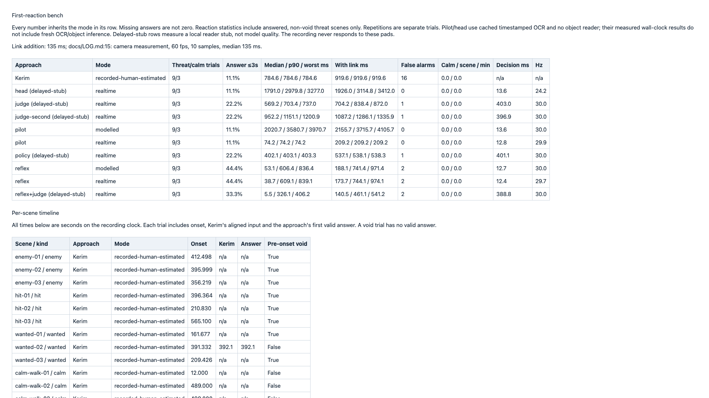
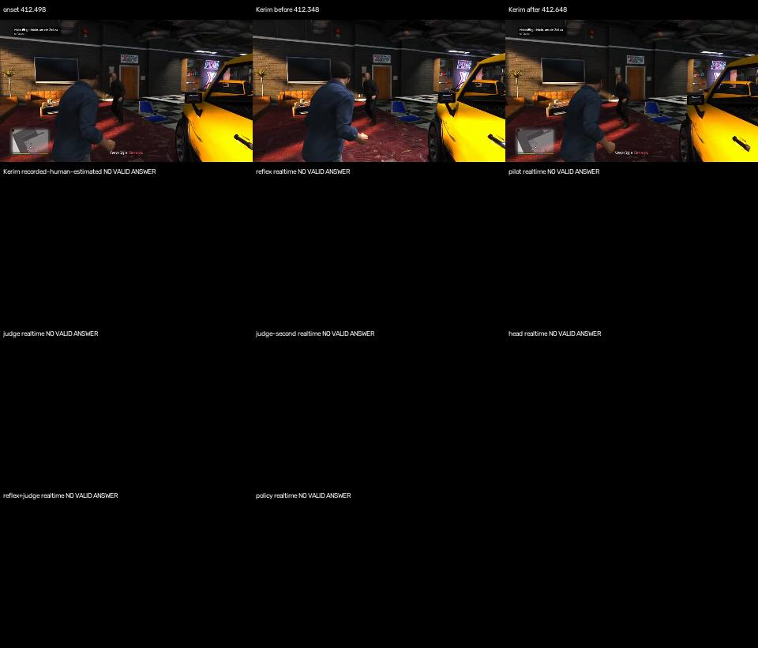
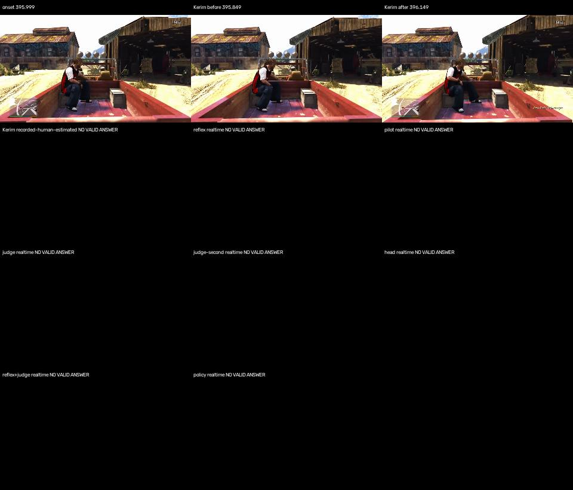
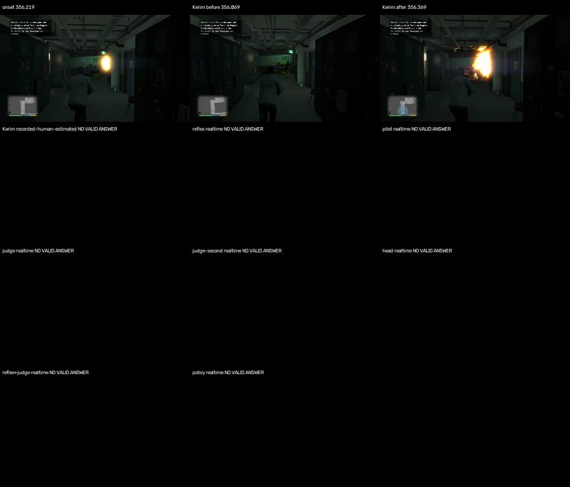
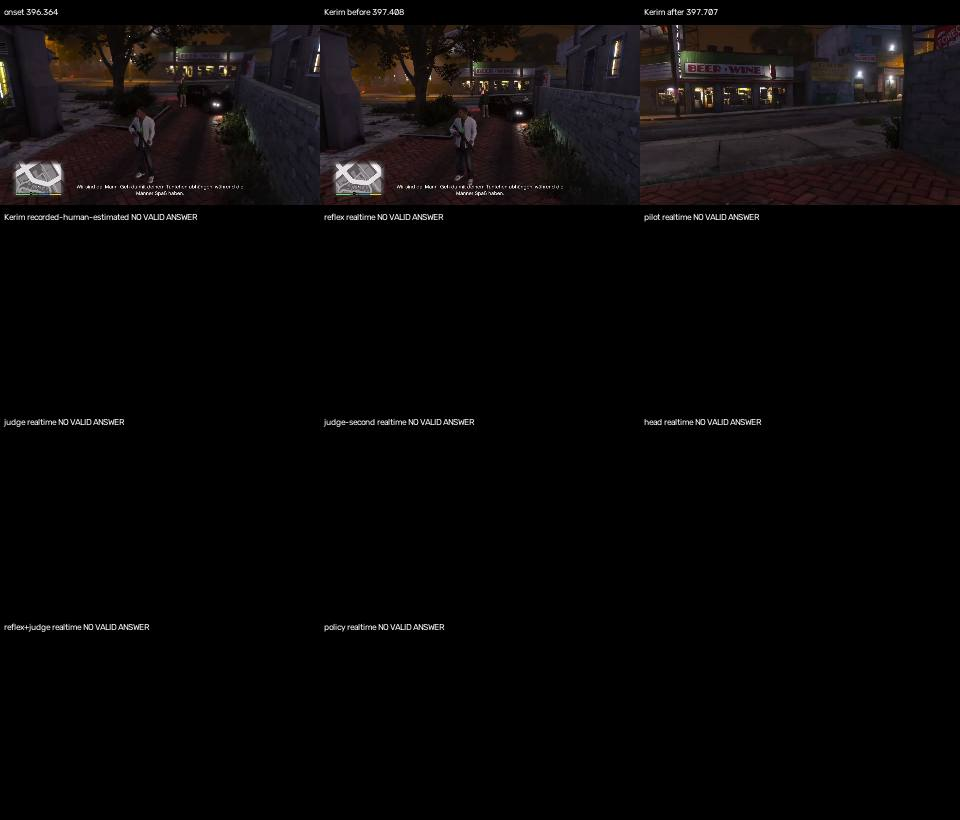
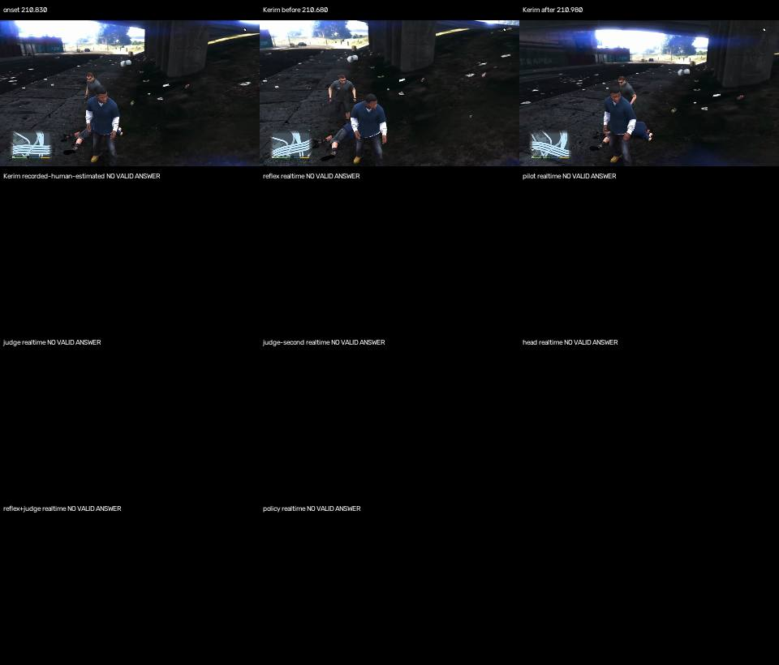
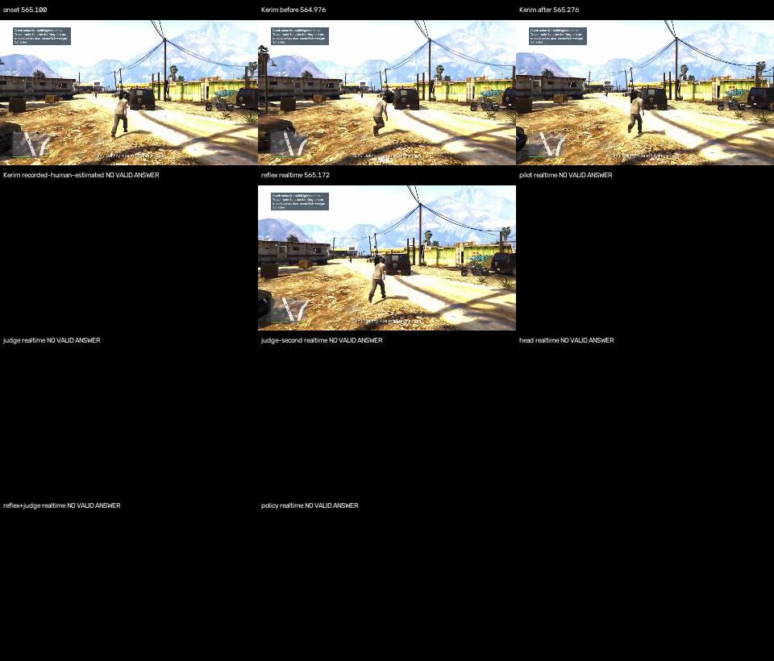
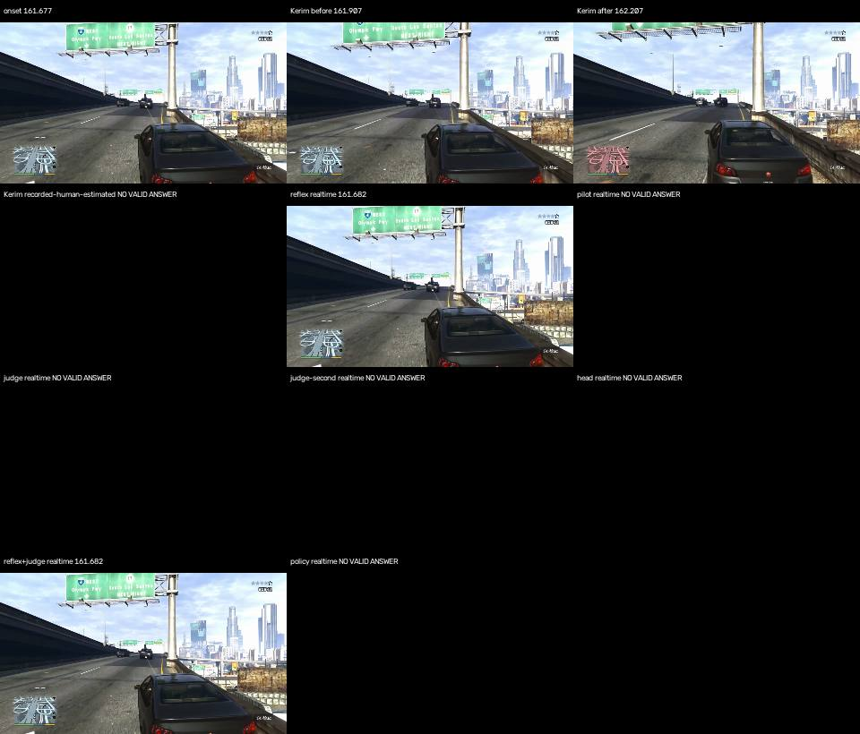
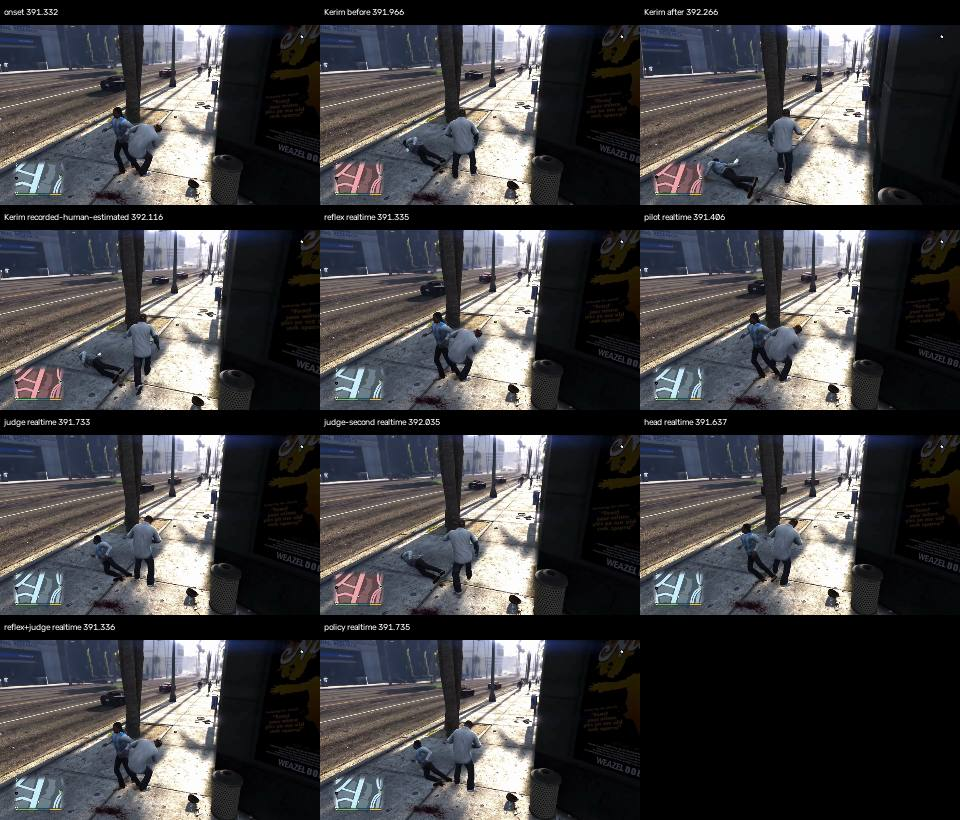
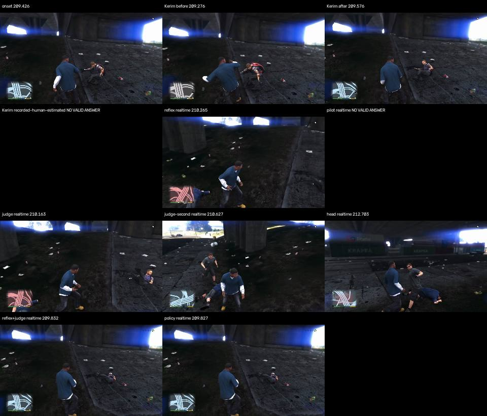

P62 is implemented and locally verified. The final run contains 84 serial realtime trials across seven variants and twelve scenes, plus 24 explicitly modelled trials for reflex and pilot. No approach errors were recorded in the final realtime run. Reflex answers four of nine threats within three seconds; the existing cached-text pilot answers one. The remaining pilot cases are failures to answer, not evidence that a 74 ms median generalizes. The nine-threat/three-control sample falls below the target and is unsuitable for a broad quality ranking.

The [standalone board](../../lab/reaction/board.html), [Markdown board](../../lab/reaction/board.md), [append-only ledger](../../lab/reaction/ledger.jsonl) and [measured cost table](../../lab/reaction/costs.json) retain the evidence. The board was opened at localhost and visually checked at 1920 by 1080, including the [scene timelines](../../lab/reaction/timeline.png). Its only browser console error was the local server's missing favicon. The table below is copied from the generated final board. Each number inherits its row's mode. Reaction medians, p90 and worst use non-void answered trials, including answers later than three seconds; the share column separately applies the three-second limit. The head's 3277 ms answer and modelled pilot's 3971 ms answer therefore affect reaction statistics but not the answered share. Decision time is the median of scene medians. For pilot/head it measures the current skill-input frame, not the model request's duration; the request-to-plan chain is retained separately.

| Approach | Mode | Threat/calm trials | Answer ≤3s | Median / p90 / worst ms | With link ms | False alarms | Calm / scene / min | Decision ms | Hz |
|---|---|---:|---:|---|---|---:|---|---:|---:|
| Kerim | recorded-human-estimated | 9/3 | 11.1% | 784.6 / 784.6 / 784.6 | 919.6 / 919.6 / 919.6 | 16 | 0.0 / 0.0 | n/a | n/a |
| head (delayed-stub) | realtime | 9/3 | 11.1% | 1791.0 / 2979.8 / 3277.0 | 1926.0 / 3114.8 / 3412.0 | 0 | 0.0 / 0.0 | 13.6 | 24.2 |
| judge (delayed-stub) | realtime | 9/3 | 22.2% | 569.2 / 703.4 / 737.0 | 704.2 / 838.4 / 872.0 | 1 | 0.0 / 0.0 | 403.0 | 30.0 |
| judge-second (delayed-stub) | realtime | 9/3 | 22.2% | 952.2 / 1151.1 / 1200.9 | 1087.2 / 1286.1 / 1335.9 | 1 | 0.0 / 0.0 | 396.9 | 30.0 |
| pilot | modelled | 9/3 | 11.1% | 2020.7 / 3580.7 / 3970.7 | 2155.7 / 3715.7 / 4105.7 | 0 | 0.0 / 0.0 | 13.6 | 30.0 |
| pilot | realtime | 9/3 | 11.1% | 74.2 / 74.2 / 74.2 | 209.2 / 209.2 / 209.2 | 0 | 0.0 / 0.0 | 12.8 | 29.9 |
| policy (delayed-stub) | realtime | 9/3 | 22.2% | 402.1 / 403.1 / 403.3 | 537.1 / 538.1 / 538.3 | 1 | 0.0 / 0.0 | 401.1 | 30.0 |
| reflex | modelled | 9/3 | 44.4% | 53.1 / 606.4 / 836.4 | 188.1 / 741.4 / 971.4 | 2 | 0.0 / 0.0 | 12.7 | 30.0 |
| reflex | realtime | 9/3 | 44.4% | 38.7 / 609.1 / 839.1 | 173.7 / 744.1 / 974.1 | 2 | 0.0 / 0.0 | 12.4 | 29.7 |
| reflex+judge (delayed-stub) | realtime | 9/3 | 33.3% | 5.5 / 326.1 / 406.2 | 140.5 / 461.1 / 541.2 | 2 | 0.0 / 0.0 | 388.8 | 30.0 |




All seven realtime variants precede Kerim on wanted-02, the only scene with a valid human reference. None is after him on that valid subset. The other eight human trials are void and have no defensible before/after ranking. The table gives onset-to-input times and their difference from Kerim's aligned 784.6 ms, without adding the shared 135 ms link. In particular, a few milliseconds of reflex latency is a capture-aligned reader/input result, not evidence of successful protection.

| wanted-02, realtime | Reaction, ms | Before Kerim, ms |
|---|---:|---:|
| reflex | 3.3 | 781.3 |
| pilot | 74.2 | 710.4 |
| judge | 401.5 | 383.1 |
| judge-second | 703.5 | 81.1 |
| head | 305.1 | 479.5 |
| reflex+judge | 4.8 | 779.8 |
| policy | 403.3 | 381.3 |

The final P62 suite passed all 13 tests in 7.09 seconds with the task-authorized local socket available. It covers timing, the pre-onset veto, calm false alarms, real and modelled delays, second-answer confirmation, hybrid withdrawal/staleness, registry extension, human clock alignment, pilot cleanup, ledger/board modes and real local HTTP paths for judge, head and policy. Ruff check and format check passed for all four Python files. The required full gate's sandbox-only failures are named individually below. Commands were run from pilot:

```sh
env -u PS5_HOST .venv/bin/python -m pytest tests/test_reaction.py -q
env -u PS5_HOST .venv/bin/ruff check src/pilot/reaction.py src/pilot/approaches.py tools/reaction.py tests/test_reaction.py
env -u PS5_HOST .venv/bin/ruff format --check src/pilot/reaction.py src/pilot/approaches.py tools/reaction.py tests/test_reaction.py
env -u PS5_HOST .venv/bin/python tools/gate.py --full
env -u PS5_HOST .venv/bin/python tools/reaction.py run reflex pilot --mode modelled --cost-table ../lab/reaction/costs.json
```

Fast mode uses the median measured step cost for each approach, cited to the final ledger revision and machine in costs.json. It cannot reproduce all wall-clock scheduling and image-processing interactions. Its extra late pilot answer on wanted-01 is modelled, not a measured improvement; no cross-mode ranking is made. The final implementation SHA-256 is `f4e0a1a16dcf905cb52114fed45550ccdf2915c7f4bde2904e636e18a88fbc36`. The ledger also records the base commit, dirty tree, scene hash and machine for each trial.

P62 adds an offline first-reaction runner, seven registered variants covering the six requested approaches, data-driven answer sets, native-frame contact sheets, an append-only ledger and a standalone Markdown/HTML board. The implementation stays within the card's file list. It does not change the conductor, skills, judge, CLI or P58 bench.

The reviewed dataset contains nine threats, three of each requested kind, and three playable on-foot controls. The thirty-plus-thirty target was not reached. Nine threats were verified, not a claim that the recordings contain only nine. Twenty-one further independent, frame-verified threat onsets and twenty-seven usable controls remain missing from this curated set. Thirty initially plausible calm label windows were rejected after looking at their sheets: most were cutscenes with stale health labels and no playable HUD. A strict search across integer-second centers in the seven retained recordings yielded three disjoint flat-map control windows without aim/fire. Vehicle controls were excluded because R2 means throttle there; they need context-specific answer definitions. This is a small diagnostic set, not a representative performance ranking.

Every accepted onset was proposed from label changes and nearby human actions, refined on native decoded RGB frames, then confirmed or moved by inspecting adjacent-frame sheets. The maximum declared uncertainty is one native frame. The enemy candidates in recording 164039 at 632.986, 648.6848 and 670.8731 were discarded because red was already visibly present before the reader changed. The 065022 candidate at 197.497 was also discarded because red was already beneath the player marker. The 092019 health candidate at 547.7011 was a transparent moving vehicle map, not a sufficiently clear hit. Full source recordings were neither copied nor modified. The source clock is frames.jsonl, never MP4 nominal FPS; capture batches and gaps remain visible in the timings.

Kerim's raw pad states are held between changes and placed on picture time as pad.t + labels.lead. The existing action labeller samples hand windows at frame.t - lead, so adding the lead is the matching inverse. All retained leads are estimated, ranging from 0.14 to 0.18 seconds. The 20 ms estimator grid is a resolution, not a confidence interval; residual systematic offset, capture batching and controller sampling remain uncalibrated. The strict pre-onset rule voids eight of his nine threat trials because an accepted state was already held in the preceding two seconds. His one valid sample supplies the displayed median and p90; they cannot support a population comparison. Raw first post-onset inputs are still shown in the sheets and scene metadata. A frame marked as a held input or a void reference is not a new deliberate response to the onset.

The benchmark releases the latest captured frame according to wall time and asks for a complete pad at 30 Hz. Compute and decode time are spent for real, and missed ticks are skipped. A model answer records its own source capture separately from the latest available frame. Detection age is unavailable here because the object Reader is disabled; it is not replaced with a cheap minimap timestamp. The 135 ms addition is LINK_SECONDS, sourced to docs/LOG.md:15: the median of ten camera measurements at a 60 fps stream. It was not measured again by this replay.

The pilot variant runs the existing Pipeline, EventDetector, MissionHead with the offline ScriptedHead fallback, Conductor and SkillRunner. Timestamped derived OCR is released after its stored processing duration and passed into both HUD classification and the conductor. This is a cached-text, no-object-reader configuration. The wall-clock rule/plan/skill measurements are real, but fresh Vision/CoreML processing and the live judge-assisted configuration were not benchmarked. The head variant additionally requests on changed minimap threat, health or wanted readings. Its HTTP mode and all other model-labelled results use the local delayed pixel-reader stub. No gaming-PC vision model, Codex inference or policy model was run, and no model-quality conclusion follows from the stub scores.

The recording does not react to the emitted inputs. These results cover first answers and initial false alarms only. They do not prove survival, aim accuracy, successful escape, successful combat or any console capability. A response matching an allowed input can also coincide with an existing plan; the chain trace, rather than the pad alone, is needed before claiming that the threat caused it.

To reproduce the local run, start the delayed server in one terminal and run the benchmark from pilot in another. No PS5_HOST value is needed or set.

```sh
env -u PS5_HOST .venv/bin/python tools/reaction.py stub --delay 0.25 --action pixels
env -u PS5_HOST .venv/bin/python tools/reaction.py scenes --sheets
env -u PS5_HOST .venv/bin/python tools/reaction.py run reflex pilot judge judge-second head reflex+judge policy --endpoint http://127.0.0.1:18762 --model delayed-stub
env -u PS5_HOST .venv/bin/python tools/reaction.py board --comparisons
```

The ledger retains the aborted and superseded trials. The board selects the current scene and implementation hashes, keeps repeated completed trials on that revision, separates model names and modes, and deduplicates the human reference. Every row carries the measured/modelled distinction; estimated human alignment is labelled separately. Missing answers are not zero. False alarms are contiguous active episodes, with matching tick counts retained separately.

The reviewer can run the actual model variants with these commands from pilot. They were prepared but not executed.

```sh
env -u PS5_HOST .venv/bin/python tools/reaction.py run judge judge-second reflex+judge --endpoint http://192.168.0.248:1234 --model qwen/qwen3-vl-8b
env -u PS5_HOST .venv/bin/python tools/reaction.py run head --endpoint http://192.168.0.248:1234 --model qwen/qwen3-vl-8b
env -u PS5_HOST .venv/bin/python tools/reaction.py run head --codex
env -u PS5_HOST .venv/bin/python tools/reaction.py board --comparisons
```

P63 receives the documented POST /policy request/reply contract and delayed stub. A real policy server, its model, deployment and console transport remain outside P62. The worked registry extension and complete protocol are in lab/reaction/README.md.

For live measurement, current play.jsonl rows contain t, frame_id, fresh, reading, skill, result, sent_pad, sent and status. run_play computes received - frame.age internally but does not write capture time or frame age into those rows. frame_id can be joined to the recording frame metadata. Missing fields are the capture and reader-source times, OCR availability, event/onset evidence, request/response/apply times, plan activation, first answering decision time and precise send time. head.jsonl has request/response t and response duration, but no capture identifier for an end-to-end join. The reviewer should add those fields in the owning modules, preserving monotonic clocks and distinguishing compute, queue, acceptance and link delay.

A future P58 threat capability needs a repeatable manually staged on-foot gameplay state with a usable far camera, a known nearby hostile encounter, full health, no wanted stars and a released human controller. The start proof must show playable HUD and no threat during the pre-onset window. The success proof must contain the first native threat frame and its predecessor, the first matching sent_pad and sent result, plus video through the expected 135 ms link interval. A threat that never appears, a held pre-onset answer or a human interruption invalidates the try. The existing P58 catalogue has no threat/fight entry, start state or corresponding proof; this task does not add one.

The first reviewer console round can use the existing commands below. The first command only prints the existing foot.view rehearsal. Before the second, the reviewer must inspect the actual gameplay picture, stage the on-foot threat, and verify that bridge /pad is clear. The second command performs a standalone twelve-second Fight recording; it is not an integrated reaction-bench result. These commands were not executed.

```sh
env -u PS5_HOST .venv/bin/python tools/bench.py run foot.view --tries 1 --minutes 3 --dry
env -u PS5_HOST .venv/bin/python -m pilot.cli play --no-level --head scripted --plan '[{"name":"fight","args":{"duration":12,"cover":"no"}}]' --seconds 12 --judge 'http://192.168.0.248:1234=qwen/qwen3-vl-8b' --record-dir /Users/kerim/recordings/pilot
```

There is no approach switch in pilot play yet. The reviewer can add an explicit approach selector in the owning CLI/conductor code and route each approach through the existing observation and pad-safety boundaries. The selector must preserve logging, neutral release, human takeover and the capability proof. Adding a benchmark name to REGISTRY alone does not wire live control.

No git mutation or PR was performed. docs/tasks/README.md explicitly says: “Git cannot write here: no commit, stash, checkout or reset. Leave your changes in the working tree; the reviewer commits them.” The direct worker instruction makes that task restriction binding. No daemon, ps5rp, console endpoint, remoteplay credentials, paid service or real model server was contacted.

The required full gate completed with 3,534 passed, 3 skipped, 236 xfailed, seven failures and six setup errors. The complete output is retained in [gate-full.log](../../lab/reaction/gate-full.log). Each failure was a sandbox refusal to bind a local socket (`PermissionError: [Errno 1] Operation not permitted`): `tests/test_bench.py::test_the_bridge_door_reads_the_status_and_posts_pad_states`, `tests/test_commentator.py::test_twitch_local_irc_handshake_ping_fragmented_chat_and_filter`, `tests/test_overlay.py::test_http_growing_log_updates_within_one_second_and_reconnects`, `tests/test_overlay.py::test_partial_malformed_and_replaced_logs_remain_usable`, `tests/test_overlay.py::test_missing_root_new_session_and_idle_end`, `tests/test_overlay.py::test_local_assets_served_without_external_dependencies`, and `tests/test_reaction.py::test_local_delayed_http_judge_policy_and_head`.

The six setup errors came from the shared CoreML detector fixture, which could not create its compiled-model working directory under `/var/folders/`. The affected tests were `tests/test_objects.py::test_real_traffic_and_player_exclusion`, `tests/test_objects.py::test_bad_frames_are_rejected[None]`, `tests/test_objects.py::test_bad_frames_are_rejected[bad1]`, `tests/test_objects.py::test_bad_frames_are_rejected[bad2]`, `tests/test_objects.py::test_reports_below_the_confidence_floor_are_left_out`, and `tests/test_objects.py::test_the_real_detector_gives_the_cut_out_figure_beside_the_filtered_list`. These are the socket/CoreML exceptions explicitly allowed by the card's Done when clause. The full gate preceded the final localized instrumentation and board corrections; the final P62 suite and lint checks are reported with the measured results above.

The wanted-01 recording is in a vehicle. Its answer is scored against the card's shared nominal input set. In particular, an R2 response there would be throttle, and an on-foot sprint pad does not establish a successful vehicle escape. That scene can diagnose detection and input latency but cannot establish tactical correctness. Future scene sets should carry action-context-specific answer definitions before comparing controller quality.

Only one pilot trial has a valid reaction, so a ranking of three finite slowest reactions does not exist. The three enemy scenes are tied censored failures through the four-second post-onset window. Their traced links below explain the missing response. Event and request times are relative to onset; differences are elapsed wall time, while CPU medians are reported separately and must not be added to the elapsed chain a second time.

| Pilot scene, realtime | Onset to first post-onset event | Event to request | Request to head completion | Completion to plan acceptance | Plan to answering pad |
|---|---:|---:|---:|---:|---|
| enemy-01 | 2106.169 ms | 2.357 ms | 0.159 ms | 29.358 ms | No answer through 4000 ms after onset |
| enemy-02 | 1571.086 ms | 2.761 ms | 0.148 ms | 29.477 ms | No answer through 4000 ms after onset |
| enemy-03 | No post-onset event | No request | No new head result | No new plan | No answer through 4000 ms after onset |

In enemy-01, the first event is HUD-present, not enemy detection. The head chooses wait for sixty seconds. In enemy-02, HUD-present eventually reaches the head, which chooses a shop waypoint and drive route, then another route attempt. Neither plan answers the threat. In enemy-03, a pre-onset walk-road plan continues without a threat event or a new request. The dominant failure in these scenes is absent threat handling, with additional HUD acceptance delay in the first two, rather than expensive rule-head computation. These findings apply to the cached-text, no-object configuration measured here.

| Realtime median CPU per stage, ms | Readers | Events | HUD events | Head when called | Plan when accepted | Skill |
|---|---:|---:|---:|---:|---:|---:|
| enemy-01 | 0.822 | 0.012 | 0.001 | 0.127 | 0.021 | 0.002 |
| enemy-02 | 0.815 | 0.009 | 0.001 | 0.087 | 0.061 | 0.002 |
| enemy-03 | 2.056 | 0.197 | 0.001 | 0.072 | 0.013 | 1.490 |

For the successful wanted-02 trial, the complete elapsed chain is onset to request 8.526 ms, request to head completion 0.169 ms, completion to accepted plan 32.330 ms, and plan acceptance to first matching pad 33.202 ms: 74.228 ms total, or 209.228 ms with the historical link median added. The head's CPU call itself takes 0.111 ms. At the answering tick, reader CPU is 3.973 ms, events 0.042 ms, HUD events 0.003 ms, skill 0.404 ms, and total step compute 5.353 ms. The latest frame is 6.328 ms old; detection and judgment ages are unavailable. Goal arbitration requests the escape plan before the debounced wanted-changed event at 509.157 ms. Tick-level plan acceptance and the following skill tick account for most of this successful reaction.

The scene inventory below gives picture-clock seconds within each original recording. All threat sheets contain adjacent native frames around the selected onset; each has one-frame declared uncertainty. The control time is only a window center and is not a threat onset. The `notes` field preserves rejected reader proposals and the visual correction where applicable.

| Scene | Recording | Onset / center, s | Lead, s | Human reference | Visual onset evidence |
|---|---|---:|---:|---|---|
| enemy-01 | 20261111-172549 | 412.4980 | 0.18 | void: held answer before onset | Replaced 065022 candidate: red was already present under player arrow. First readable red with HUD appearing at native frame 24610, preceding frame 24609 has no HUD. |
| enemy-02 | 20261112-092019 | 395.9990 | 0.18 | void: held answer before onset | Moved from reader proposal 396.100: native frame 23428 first visible red blips, frame 23427 has map but no red. |
| enemy-03 | 20261111-185323 | 356.2190 | 0.16 | void: held answer before onset | Native frame 21301 first red blips and muzzle flash, frame 21300 has neither. |
| hit-01 | 20261111-190825 | 396.3643 | 0.18 | void: held answer before onset | Label proposal 396.3980; native reader initial=0.6222222222222222; first change=396.3821. |
| hit-02 | 20261111-065022 | 210.8304 | 0.16 | void: held answer before onset | Label proposal 210.8982; native first change 210.8304. |
| hit-03 | 20261112-092019 | 565.0997 | 0.18 | void: held answer before onset | Label proposal 565.0997; native reader initial=None; first change=565.0997. |
| wanted-01 | 20261112-085011 | 161.6769 | 0.14 | void: held answer before onset | Label proposal 161.7632; native reader initial=0; first change=161.6769. |
| wanted-02 | 20261111-182316 | 391.3316 | 0.16 | valid | Label proposal 391.3316; native reader initial=0; first change=391.3316. |
| wanted-03 | 20261111-065022 | 209.4257 | 0.16 | void: held answer before onset | Label proposal 209.4917; native reader initial=0; first change=209.4257. |
| calm-walk-01 | 20261111-065022 | 12.0000 | 0.16 | calm control | Ordinary on-foot idle/look/walk. Null wanted samples allowed only with continuous flat HUD. No vehicle controls scored as combat inputs. |
| calm-walk-02 | 20261111-172549 | 489.0000 | 0.18 | calm control | Ordinary on-foot idle/look/walk. Null wanted samples allowed only with continuous flat HUD. No vehicle controls scored as combat inputs. |
| calm-walk-03 | 20261111-172549 | 499.0000 | 0.18 | calm control | Ordinary on-foot idle/look/walk. Null wanted samples allowed only with continuous flat HUD. No vehicle controls scored as combat inputs. |

The nine comparison panels below show the onset, frames around Kerim's aligned first input (150 ms before and after), his answer-time frame, and one answer frame for every realtime approach. A missing or void answer gets an explicit blank tile; no substitute frame is presented as an answer. The human raw input remains visible even where the pre-onset rule voids it. These panels contain realtime trials only.




















The retained lab/reaction artifacts total 4,144,889 bytes, below the 5 MB limit. All nine comparison panels and the final board were visually inspected. The local stub, browser session and temporary static server were closed. No source recordings were changed.
